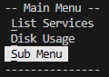
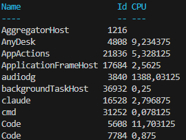
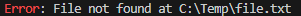

# PSSomeCLIThings

A PowerShell module for building interactive CLI interfaces: dialog system with forms, menus, console formatting, string utilities, and process helpers.

## Features

### Dialog System
Build interactive CLI dialogs with textboxes, buttons, checkboxes, radio buttons, and more. See the [full Dialog documentation](doc/DIALOG.md) for architecture details, component reference, patterns, and examples.

#### Base Components

| Function | Description |
|---|---|
| `New-CLIDialog` | Main orchestrator that assembles a complete interactive dialog from rows of controls. Handles keyboard navigation, focus management, validation, and result collection. |
| `New-CLIDialogButton` | Creates an interactive button control with support for value selection, action types (Yes, No, Cancel, Exit, Back, etc.), scriptblock execution, and keyboard shortcuts via "&" notation. |
| `New-CLIDialogCheckBox` | Creates a checkbox control for independent multi-selection. Displays as `[x]`/`[ ]` with keyboard shortcut support and custom object association. |
| `New-CLIDialogRadioButton` | Creates a radio button control for single selection within a group. Displays as `(x)`/`( )` with automatic mutual exclusion. |
| `New-CLIDialogTextBox` | Creates an editable text input field with cursor navigation, text selection (Shift+Arrows), clipboard support (Ctrl+C/V/X), input history (Ctrl+Up/Down), multi-line mode with scrolling viewport, regex or scriptblock validation, password masking, SecureString support, and visual error feedback. |
| `New-CLIDialogObjectsRow` | Container row that groups multiple controls in horizontal or vertical layouts with keyboard navigation, labeled headers, and radio button mutual exclusion. |
| `New-CLIDialogProperty` | Read-only property display element showing labeled information with regex pattern highlighting and aligned layouts. |
| `New-CLIDialogText` | Text display element supporting static or dynamic content via scriptblock, multi-line text, and custom colors. |
| `New-CLIDialogSeparator` | Visual separator line with customizable character, pagination indicators, centered text, and "press any key" functionality. |
| `New-CLIDialogSpace` | Horizontal space element for creating gaps between controls in a row. |
| `New-CLIDialogTableItems` | Generates dialog rows displaying objects in a formatted table layout as checkboxes or buttons. |
| `New-DialogResultAction` | Creates a structured DialogResult object for action-type button results (Yes, No, Cancel, Validate, Exit, Back, etc.). |
| `New-DialogResultScriptblock` | Creates a structured DialogResult object for scriptblock-type button results. |
| `New-DialogResultValue` | Creates a structured DialogResult object for value/object selection button results. |

#### High-Level Dialogs

| Function | Description |
|---|---|
| `Invoke-CLIDialog` | Primary entry point for displaying and interacting with dialogs. Supports simple display, validation loops, and execution mode for nested menus/wizards. |
| `Invoke-YesNoCLIDialog` | Convenience function for Yes/No/Cancel confirmation dialogs with customizable button text, layouts, and keyboard shortcuts. |
| `Find-Object` | Dynamic interactive search dialog with real-time filtering, paginated results, single/multi-select modes, and confirmation support. |
| `Edit-Hashtable` | Interactive dialog for editing hashtable values with labeled textboxes for each key-value pair. |
| `Connect-CLIDialogPSSession` | Connects to a remote computer via PSSession with interactive credential dialog, automatic retry on failure, and credential-aware error handling (clears credentials on authentication errors). |
| `Read-CLIDialogConnectionInfo` | Prompts for connection information (server, port, username, password) with regex validation and credential reuse support. |
| `Read-CLIDialogCredential` | Simplified credential prompt (username/password) returning a PSCredential object. Wrapper around Read-CLIDialogConnectionInfo. |
| `Read-CLIDialogHashtable` | Dynamic form dialog from a hashtable schema with per-field regex validation and optional Cancel button. |
| `Read-CLIDialogIP` | IP address input dialog with IPv4 validation and optional CIDR mask support. |
| `Read-CLIDialogNumericValue` | Numeric value input dialog with integer/decimal support, min/max range validation, and default values. |
| `Read-CLIDialogValidatedValue` | Generic single-field validation dialog accepting regex or scriptblock validation. Building block for specialized input functions. |
| `Select-CLIDialogCSVFile` | Interactive CSV file selector with header validation and content preview. |
| `Select-CLIDialogJsonFile` | JSON file selector that parses and displays file metadata with optional filtering and auto-selection. |
| `Select-CLIDialogObjectInArray` | Comprehensive paginated object selection dialog with single/multi-select, confirmation, custom menu items, and navigation. |
| `Select-CLIFileFromFolder` | File selector from a folder with recursive scanning, manual path entry, and file validation. |
| `Invoke-CLIDialogWizard` | Manages a succession of dialog steps to build an object progressively, with Back navigation and Exit support. |
| `New-CLIDialogWizardStep` | Creates a step definition for `Invoke-CLIDialogWizard` with a property name, scriptblock, and optional header. |

#### Theme

| Function | Description |
|---|---|
| `Get-CLIDialogTheme` | Retrieves the current dialog theme or a specific color property. Initializes the default theme on first call. Used by all components to resolve default colors. |
| `Set-CLIDialogTheme` | Sets or resets the global dialog theme. All color parameters have standard defaults; only pass what you want to change. |

### Object Dialog Engine

A convention-driven engine that renders any object as an interactive, paginated dialog — property view, content tables, per-object menus and actions on embedded values — without the engine knowing anything about your domain. The host project supplies behaviour by defining functions whose names follow a contract (see below), and registers a default footer menu once via `Set-CLIDialogDefaultMenu`.

| Function | Description |
|---|---|
| `Show-CLIDialogObject` | Engine entry point. Displays an object (optionally a named view), running the connect/convert/expand steps, building the dialog and driving the Back/Exit/Previous/Next/Refresh loop. This is the function you call. |
| `New-CLIDialogObjectBuilder` | Builds a stateful, paginated builder for an object (header, properties, content, menu) exposing navigation methods (`GetDialog`, `NextPage`, `PreviousPage`, `Refresh`, ...). |
| `Get-CLIDialogObject` | Assembles a single dialog form from an object's properties, optional paginated content table, object menu and footer menu. |
| `Get-CLIDialogConnectFunction` | Resolves, by convention, the connection function to run before an object can be displayed. |
| `Set-CLIDialogDefaultMenu` | Registers the default footer menu provider (a scriptblock) injected by the engine when no explicit menu override is given. Keeps the module project-agnostic. |
| `Get-CLIDialogDefaultMenu` | Returns the registered default footer menu provider. |

#### Convention contract

The engine resolves behaviour from functions the host project defines, named after the object's type and/or the requested function. `<Type>` is a PSTypeName with spaces removed; `<Func>` is the requested function name with spaces removed. For each row the engine tries the candidates in order and uses the first one that exists; all are optional unless stated.

| Convention (in resolution order) | Purpose |
|---|---|
| `Connect-<Type>To<Func>` → `Connect-<Func>` → `Connect-<Func>_GUI` | Connection step, run first; may return a `DialogResult.Action.Cancel` to abort the display. |
| `Convert-<Type>To<Func>` | Transform the object before it is rendered. |
| `Expand-<Type>-<Func>_Object` → `Expand-<Type>_Object` | Enrich the object up-front. |
| `Get-<Type>_ObjectName` | Display name for the header (else `.Name`, else `.ToString()`). |
| Property registry (`Register-CLIObjectProperty`, see below) → `Get-<Type>-<Func>_ObjectProperties` → `Get-<Func>_ObjectProperties` → base-view registry inheritance → `Get-<Type>_ObjectProperties` | Property descriptors to display, resolved by `Get-CLIObjectPropertyList`. |
| `Add-<Type>Properties [-Properties]` | Load/compute the requested properties for sparse objects (resolved over the whole type hierarchy, first match wins). |
| `Get-<Type>-<Func>_ObjectContent` → `Get-<Type>_ObjectContent` | Paginated content table. |
| Menu registry (`Register-CLIMenuButton`, see below) → `Get-<Func>_ProjectMenu` → `Get-<Type>-<Func>_ProjectMenu` → `Get-<Type>_ProjectMenu` | Per-object menu, built by `New-CLIDialogMenuFromRegistry`. |
| `Get-<Type>_DefaultProperty` | Default function name used when `-Function` is omitted. |
| `Invoke-<Type>-<Func>_FunctionOnObject` → `Invoke-<Type>_FunctionOnObject` | Action run on a selected value; when none exists, selecting a value recurses into `Show-CLIDialogObject`. |

#### Wiring

The host registers the default footer menu once at startup (and may configure colors):

```powershell
Set-CLIDialogDefaultMenu { Get-MyProjectMenu }   # e.g. a Back / Search / Exit row
Set-CLIDialogTheme -HighlightColor Cyan
```

Then display any object — the engine discovers the matching convention functions automatically:

```powershell
# Default view (uses Get-<Type>_DefaultProperty)
Show-CLIDialogObject $user

# A named view (resolves Get-<Type>-AllInfo_ObjectProperties, etc.)
Show-CLIDialogObject $computer "All Info"
```

#### Declarative registries (menus & properties)

Both the per-object menu and the displayed property list can be assembled from declarative **registries** instead of `Get-<…>_ProjectMenu` / `Get-<…>_ObjectProperties` functions. A module contributes to the registries by dot-sourcing two conventional files at load time (alongside its other functions): `_Menu.ps1` (buttons), `_Properties.ps1` (properties), plus `_Types.ps1` for IS-A type aliases. This lets a *client/custom* module **add, override or hide** entries for a given environment without touching the base module — e.g. renaming Trellix "Custom property 1..8" to a customer's real meaning, or hiding a property.

| Function | Description |
|---|---|
| `Register-CLIMenuButton` / `New-CLIDialogMenuFromRegistry` | Register a menu button (Type, MenuRow, Name, Text, Object, Function, Filter, Order) / build the menu rows for an object. |
| `Register-CLIObjectProperty` / `Get-CLIObjectPropertyList` | Register a property (Type, Name, Header, Expression, Function, Filter, After/Before/Order, HideIfEmpty, Options; or `-Hide`) / build the ordered property descriptors for an object+view. |
| `Register-CLIMenuTypeAlias` / `Resolve-CLIMenuType` | Declare that a concrete type *is also* a generic token (e.g. `ADComputer` → `Computer`) / resolve an object's ordered type tokens (specific → generic → `*`). |
| `Clear-CLIMenuRegistry` / `Clear-CLIPropertyRegistry` | Reset a registry (reload-safe; registration also auto-initialises and replaces same `(Type, Name)` in place). |

Shared rules: entries are keyed by **type token** then a **unique, stable `Name`** (e.g. `ADUser.LogonInfo.PasswordExpired`) — the Name is the override/hide/anchor key and a future i18n key, never the displayed label. `Function` scopes the entry to a view (`""` = base, `"<view>"`, or `"*"` = all). `Filter` is a per-object predicate (a filter that throws hides the entry). Entries resolve from the most specific type token to the most generic, then by declaration order.

Property resolution (`Get-CLIObjectPropertyList`) stays faithful to the legacy chain: the registry view wins; otherwise a legacy `Get-<Type>-<Func>_ObjectProperties` is consulted (so a `$null`-returning content-view function still suppresses the property block); otherwise a non-base view inherits the type's **base** (`Function ""`) registry properties; otherwise the legacy base function. A type with no registered entry behaves exactly as before (legacy functions).

```powershell
# In a base module's _Properties.ps1
Register-CLIObjectProperty -Type ADUser -Name "ADUser.Department" -Header "Department" -Expression { $_.department }

# In a client/custom module's _Properties.ps1 (loaded after the base)
Register-CLIObjectProperty -Type ADUser -Name "ADUser.EmployeeId" -Header "Matricule" `
    -Expression { $_.employeeID } -After "ADUser.Department"     # add, positioned by anchor
Register-CLIObjectProperty -Type ADUser -Name "ADUser.Company" -Hide                       # hide a base property
```

### Menu Builder
Create interactive navigable menus with sub-menus, actions, and scriptblock execution.

| Function | Description |
|---|---|
| `Invoke-Menu` | Displays and executes an interactive menu with nested sub-menu support, scriptblock execution, and depth tracking. |
| `New-Menu` | Creates a menu object with items, sub-menus, pagination, keyboard shortcuts, enter/exit actions, and separator width mode (AutoLength or FullWidth). |
| `New-MenuItem` | Creates an executable menu item that runs a scriptblock when selected, with keyboard shortcut and recommended flag. |
| `New-MenuAction` | Creates a menu action button for navigation (Back, Exit, Yes, No, Cancel, Validate, Previous, Next, Refresh, etc.). |
| `New-MenuRow` | Creates a grouped menu row with a header label and content items for organizing related elements. |

### Console Formatting
Custom formatting utilities for tables and lists with color support.

| Function | Description |
|---|---|
| `Format-TableCustom` | Advanced table formatter with custom column widths, colored headers, content truncation, ANSI color support, and string output mode. |
| `Format-CustomHeaderTable` | Formats objects as a table with colored and optionally underlined header row. |
| `Format-ListCustom` | Custom list formatter (like `Format-List`) with colored property names, alignment control, and regex-based value highlighting. |
| `Format-PropertyToList` | Renders a single property-value pair in list format with colored output and multi-value array support. |
| `Format-ArrayHashtable` | Converts an array of hashtables into PSCustomObjects and displays as a formatted table. |
| `Get-ColumnFormat` | Analyzes object properties to determine optimal column formatting metadata (alignment, width, type). |

### String Utilities
ANSI text formatting and underline support.

| Function | Description |
|---|---|
| `Set-StringFormat` | Applies ANSI text formatting (underline, bold, italic, blink) to a string or substring with support for ranges and single positions. |
| `Set-StringUnderline` | Convenience wrapper for `Set-StringFormat` that applies underline formatting. |

### Other Utilities
Miscellaneous CLI helper functions.

| Function | Description |
|---|---|
| `Write-ColoredString` | Writes a string to the console with regex-based color highlighting for matching and non-matching portions. |
| `Write-Separator` | Writes a separator line with optional pagination indicators (arrows, page numbers). |
| `Invoke-Pause` | Pauses script execution until a key is pressed, with customizable message and replacement behavior. |
| `Invoke-Process` | Launches an external process capturing stdout, stderr, and exit code with configurable output levels. |
| `Convert-ConsoleColorToInt` | Converts ConsoleColor enum values to ANSI escape sequence numeric codes (foreground/background). |
| `Wait-ProgressBar` | Displays a countdown progress bar for a specified duration in seconds. |
| `Read-Array` | Reads a multi-line list from user input via Read-Host with optional regex-based grouping. |

## Requirements

- **PowerShell** 5.1 or later
- **Windows** operating system (uses `System.Console` and `Write-Host` for rendering)

## Installation

```powershell
# Clone or copy the module to a PowerShell module path
Copy-Item -Path ".\PSSomeCLIThings" -Destination "$env:USERPROFILE\Documents\PowerShell\Modules\PSSomeCLIThings" -Recurse

# Or import directly
Import-Module ".\PSSomeCLIThings\PSSomeCLIThings.psd1"
```

## Quick Start

### Simple Yes/No dialog
```powershell
$answer = Invoke-YesNoCLIDialog -Message "Do you want to continue?" -YN
# Returns "Yes" or "No"
```


### Build a form dialog
```powershell
# Collect user information via a hashtable form
$schema = [ordered]@{
    Name     = @{ Regex = "^.{2,50}$"; Text = "" }
    Email    = @{ Regex = "^[\w.]+@[\w.]+\.\w+$"; Text = "" }
    Age      = @{ Regex = "^\d{1,3}$"; Text = "" }
}
$result = Read-CLIDialogHashtable -Properties $schema -Header "Please enter your information"
```


### Interactive object selection
```powershell
# Select a service from a paginated list
$service = Get-Service | Select-CLIDialogObjectInArray -SelectedColumns Name, Status, DisplayName `
                                                       -Sort Name `
                                                       -ItemsPerPage 15
```


### Build a menu
```powershell
$menu = New-Menu -Text "Main Menu" -Content @(
    New-MenuItem -Text "&List Services" -Content { Get-Service | Format-Table }
    New-MenuItem -Text "&Disk Usage" -Content { Get-PSDrive -PSProvider FileSystem | Format-Table }
    New-Menu -Text "&Sub Menu" -Content @(
        New-MenuItem -Text "&Option 1" -Content { Write-Host "Option 1 selected" }
        New-MenuItem -Text "&Option 2" -Content { Write-Host "Option 2 selected" }
    )
)
Invoke-Menu -Menu $menu
```

 

### Custom formatted table
```powershell
Get-Process | Select-Object -First 10 | Format-TableCustom -Property Name, Id, CPU -HeaderColor Cyan -HeaderUnderline
```



### Colored string output
```powershell
"Error: File not found at C:\Temp\file.txt" | Write-ColoredString -Pattern "Error" -MatchForegroundColor Red
```



## Module Structure

```
PSSomeCLIThings/
├── PSSomeCLIThings.psd1          # Module manifest
├── PSSomeCLIThings.psm1          # Module loader (dot-sources all .ps1 files)
├── README.md                     # This file
├── LICENSE                       # PolyForm Noncommercial License 1.0.0
├── Dialog/
│   ├── Base/                     # Core dialog building blocks (14 functions)
│   ├── Theme/                    # Centralized color theme (2 functions)
│   └── *.ps1                     # High-level dialog functions (14 functions)
├── Object/                       # Convention-driven object dialog engine (6 functions)
├── Format/                       # Console formatting utilities (6 functions)
├── Menu/                         # Menu builder (5 functions)
├── Other/                        # Miscellaneous CLI helpers (7 functions)
└── String/                       # String formatting utilities (2 functions)
```

## Author

**Loïc Ade**

## License

This project is licensed under the [PolyForm Noncommercial License 1.0.0](https://polyformproject.org/licenses/noncommercial/1.0.0/). See the [LICENSE](LICENSE) file for details.

In short:
- **Non-commercial use only** — You may use, modify, and distribute this software for any non-commercial purpose.
- **Attribution required** — You must include a copy of the license terms with any distribution.
- **No warranty** — The software is provided as-is.
